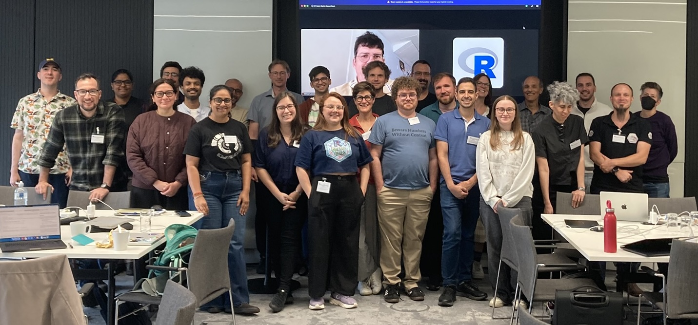
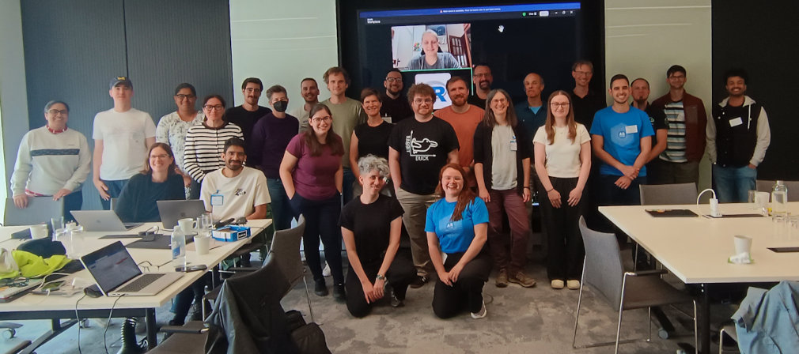
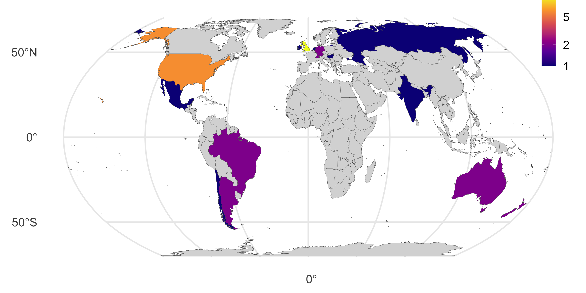
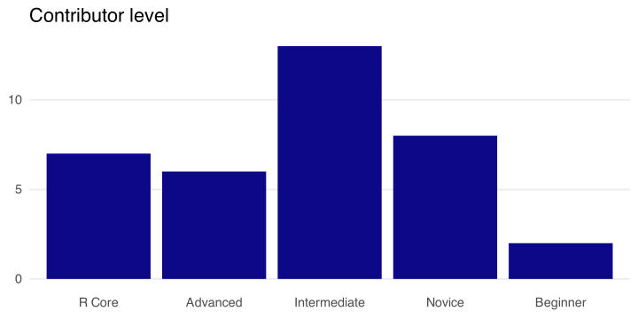

R Project Sprint 2026
================
truetrue
2026-10-20

## Introduction

R Project Sprint 2026 was a three-day event hosted at the University of
Birmingham, UK. The aim of the event was to bring novice and experienced
contributors together to work collaboratively with members of the R Core
Team, who maintain and develop the code and documentation that forms the
base distribution of R (“base R”).

This was the second R Project Sprint, following the successful inaugural
event in 2023 (Turner and Becker 2023). The sprint was organised as part
of the Research Software Maintenance Fund (RSMF) project [*Enabling the
Next Generation of Contributors to
R*](https://blog.r-project.org/2025/12/17/rsmf-enabling-the-next-generation-of-contributors-to-r/index.html),
which incorporated plans for one sprint in Europe and a second sprint in
the USA in 2027. Core funding for the sprint was provided by the R
Consortium, covering the venue, catering and travel bursaries, while the
R Foundation provided additional travel support for R Core developers.

## Participants

Members of the R Core Team, RSMF project team, or the Bug Triage and
Patch Team were guaranteed a place if they could partipate. This
accounted for 18 participants including 7 members of the R Core Team.
Another 18 participants - along with a couple more who were ultimately
unable to participate - were selected from the self-nominated
applicants. Figure @ref(fig:photos) shows group photos taken on Day 1
and Day 3 of the sprint, a full [list of
participants](https://contributor.r-project.org/r-project-sprint-2026/participants/)
is on the sprint website. Participation was in-person by default, but
exceptions were made in a few cases where travel was not possible, e.g.,
due to visa issues or caring commitments.

Photos of sprint participants on Day 1 (top) and Day 3 (bottom)
including online participants on screen (not all participants
photographed).

Members of demographic groups underrepresented within the contributor
community were encouraged to apply for a place, by promoting the event
to affinity groups (R-Ladies+, rainbowR, and LatinR) and by direct
communication with potential participants. Figure @ref(fig:map) shows
the country of residence for the 36 participants. There were 18 based in
Europe with 10 from the UK; 7 based in Latin America; 6 from the USA; 4
based in Oceania, and one based in India.

Choropleth showing the distribution of participants’ country of
residence on the world map.

Compared to the sprint in 2023, there was lower representation of people
based in Africa, the Middle East, and Asia. We received only a small
number of applications from these regions, possibly due to a shorter
lead time, making it less feasible for people that would need a visa to
attend in person. Although remote participation was an option, it was
preferred to offer this to contributors with some experience, who could
work more independently. Since 2023, we have been running [R Dev
Days](https://contributor.r-project.org/events/r-dev-days/), where it is
easier to support new contributors in person or online.

Of the 25 participants that consented to share further demographic
information, 16 may be regarded as underrepresented in the R developer
community due to gender, ethnicity, sexual orientation, and/or
disability status. There were 7 participants that identified as Arab,
Asian or Pacific Islander, Black/African/Caribbean, or from Indigenous,
aboriginal, or multiple ethnic groups.

The selection committee assessed the experience of the invited/selected
contributors based on the information in their nomination form and/or
personal knowledge. In contrast to 2023, a new category of “novice” was
introduced - this was applied to people with a little experience of R
contribution, typically from attending an R Dev Day. As can be seen in
Figure @ref(fig:skills), most participants had at least this level of
experience, reflecting the impact of outreach initiatives in recent
years. However, the selection committee still aimed to balance the
numbers of novice/beginner contributors against the number of advanced
contributors or core developers. For this sprint, we focused on
programming contributions rather than translation contributions, which
are better suited to the R Dev Days or short hackathons.

Histogram of participants’ level of expertise in R contribution, as
judged by the selection committee.

## Preparation

There were two sides to preparation for the sprint: gathering suitable
tasks to work on and helping participants brush up their knowledge and
skills.

Several tasks were proposed by R Core Team, others were selected issues
from R’s Bugzilla (<https://bugs.r-project.org>), or proposed by the
sprint participants. Following the practice of recent R Dev Days,
proposed tasks for the sprint were gathered on a [GitHub project
board](https://github.com/orgs/r-devel/projects/13). This allowed issues
to be added from existing GitHub repositories, such as the one used for
R Dev Days or the one used by the translations infrastructure team, as
well as allowing fresh ideas to be proposed. The board provided a way
for participants to assign themselves to issues and record the progress
of tasks.

In the lead-up to the sprint, new contributors were encouraged to watch
[YOU can contribute to base
R!](https://opensource.posit.co/resources/videos/2026-05-18_you-can-contribute-to-base-r-ella-kaye-data-science-lab/),
a video recording of a recent Data Science Lab where Ella Kaye
demonstrates working through a bug fix using the [R Dev
Container](https://github.com/r-devel/r-dev-env), and then to practice
the basic contribution workflow themselves by working through the
“Building R” and “R Contribution Workflow” tutorials in the [R Dev
container docs](https://contributor.r-project.org/r-dev-env/).
Participants were also pointed of a list of further [learning
resources](https://github.com/r-devel/r-dev-day/blob/main/participant_resource_list.md)
maintained on the R Dev Day repository.

## Format

Each sprint day started with a kick-off session and ended with a
report-back session, both hybrid to include our online participants. The
remaining time was spent working in small groups, sometimes arranging
hybrid meetings to discuss specific issues. A room laptop was kept
connected to the online sessions set up for remote participants, so that
it was easy for in-person participants to chat to remote participants on
an ad-hoc basis.

In the kick-off session on the first day, Martin Maechler gave a 10
minute overview of how people can contribute to base R, highlighting
some particular projects. All the R Core members present gave a brief
introduction to themselves, highlighting their areas of interest and any
particular issues they wanted to work on at the sprint. On the second
day, Mikael Jagan gave a 10 minute talk on his experience as the newest
member of the R Core Team. Beyond these introductions, participants used
the daily kick-off sessions to collectively match people to tasks and
raise any requests for help or make other announcements.

The report-back sessions were used to review progress and give an
opportunity for quick questions or feedback. For the second report-back
session, we were joined remotely by members of the University of
Birmingham R User Group - several in-person participants were also
members of this group, so it was nice to be able to share progress with
them.

Both lunch and dinner were provided at the conference venue, except on
the last day when those who were able to stay ventured out to some local
places for dinner.

## Contributions to R

The main focus of the sprint was the development of code and
documentation in the base R distribution. Figure @ref(fig:issues) shows
the progress of related issues at the end of the sprint and two months
after. An issue is considered closed if a corresponding bug report on
R’s Bugzilla was closed or if a corresponding patch was committed to
base R. By the end of the sprint, five issues had been closed, with
patches for more than two-thirds of the remaining 22 issues.

Two months after the sprint…

Status of issues at the end of the sprint and two months after

Package-related issues included [preventing leakage between package
vignettes](https://bugs.r-project.org/show_bug.cgi?id=18226), adding
support to [load multiple packages in one `library()`
call](https://github.com/r-devel/r-project-sprint-2026/issues/31),
developing an approach to [inline images in HTML
help](https://github.com/r-devel/r-project-sprint-2026/issues/15), and
various issues related to broadening the support for package binaries,
e.g., [enabling custom binaries on
Windows](https://github.com/r-devel/r-project-sprint-2026/issues/15).

The low-level issues included [adding a warning when a logical subscript
is fractionally
recycled](https://bugs.r-project.org/show_bug.cgi?id=19155), developing
a [proposal for a hierarchy of typed
errors](https://github.com/r-devel/r-project-sprint-2026/issues/28), and
[adding support to register a function to be called before an expression
is evaluated](https://bugs.r-project.org/show_bug.cgi?id=19154).

Issues related to general R development included [detection of Fortran
(and other) compilers in R’s
configure](https://github.com/r-devel/r-project-sprint-2026/issues/11),
proposing a [system to manage
deprecation](https://github.com/r-devel/r-project-sprint-2026/issues/18),
and developing a [script to install a set of minimal packages to run
`make check-all`](https://github.com/r-devel/r-project-sprint-2026/issues/14).

Statistics issues included developing an [SE generic and
methods](https://github.com/r-devel/r-project-sprint-2026/issues/22),
[improve the error message for failed `contrasts<-` in
`model.matrix.default`](https://github.com/r-devel/r-project-sprint-2026/issues/29),
and [testing the updated algorithm for computing Kendall’s
tau](https://github.com/r-devel/r-dev-day/issues/151).

The main issue for translation was to prepare a patch of recent
translations contributed via the community-maintained [Weblate
instance](https://translate.rx.studio/projects/r-project/). Following
discussions at R Dev Day @ useR! 2026, there was also work to change how
the source location of translated strings is recorded in the translation
files, reducing churn in version control. An investigation of potential
solutions to retrieving the English error message after an error has
been thrown in another language moved to a proposal after the sprint,
which would become possible if the proposal for typed errors is
implemented.

The miscellaneous issues were [improving subsetting of `rle`
objects](https://bugs.r-project.org/show_bug.cgi?id=17852#c15) and
[ensuring `path.expand('~')` returns
UTF-8](https://bugs.r-project.org/show_bug.cgi?id=18949).

Finally there was one graphics issue, regarding [white stripes on Cairo
images](https://bugs.r-project.org/show_bug.cgi?id=16721).

## CRAN packages and CRAN support

Although the R Project Sprint focuses on base R, some tasks were
proposed to contribute to CRAN packages due to changes in the
development version of R or changes in the CRAN checks. These included
[fixing unintentional use of fractional recycling in
](https://github.com/therneau/survival/pull/343) and [patching packages
relying on internal classes used in method
dispatch](https://github.com/r-devel/r-dev-day/issues/157). There was
continued work on [fixing the “Lost braces” NOTE on CRAN
packages](https://github.com/r-devel/r-dev-day/issues/179), which not
only resulted in patches to nearly 20 packages, but also implemented
automated tracking using an online spreadsheet, for use by contributors
and CRAN maintainers.

Another task related more directly to supporting the CRAN Team:
developing code to [create issues on GitLab or Codeberg to ask for a new
maintainer email](https://github.com/r-devel/r-dev-day/issues/178).

## Translation and translation infrastructure

The sprint provided an opportunity for Gergely Daróczi, who set up the
Weblate instance in 2022, to onboard Bea Fernandez and Fernando Corrêa
as administrators. In addition to collaborating on the translation
patch, they made a fresh checkout of the `.po` files from the R SVN
repository and updated the Weblate configuration to reduce the ad-hoc
fixes required to generate a clean patch.

The team also worked to unlock Weblate components for the recommended
packages that had been locked due to git conflicts. They identified an
improved configuration that would avoid one type of issue in future.

Although it was not a main task at the sprint, one participant did join
the Weblate instance and added a few French translations in between
other tasks!

Another translation-related activity was testing the
[rdlocal](https://github.com/eliocamp/rdlocal) package, updated by
Aditya Bansal in a [Google Summer of Code
project](https://summerofcode.withgoogle.com/programs/2026/projects/HoPu7Sqq)
to provide prototype infrastructure for adding multilingual help pages
to an R package. This was the latest development in work that came out
of a discussion at R Project Sprint 2023, carried forward by Elio
Campitelli, who mentored the GSoC project and joined the 2026 sprint
remotely from Australia! Testing at the sprint revealed a number of
issues and pull requests were made to fix several of them. Interested
contributors are welcome to work on the remaining open issues.

## Contributor infrastructure

A number of participants worked on an [accessibility
audit](https://github.com/r-devel/r-project-sprint-2026/issues/2) of the
[R Contributor Website](https://contributor.r-project.org), the [R
Development Guide](https://contributor.r-project.org/rdevguide/) and the
[R Dev Container Docs](https://contributor.r-project.org/r-dev-env/).
The team opened issues on the relevant repositories where improvements
were needed and opened pull requests to fix several of these issues.

Other work on contributor infrastructure included testing and revising
the instructions for installing R from source on macOS, for later
addition to the R Dev Guides

## Summary

R Project Sprint 2026 was a productive event, where participants made a
wide variety of contributions to base R, CRAN packages and
infrastructure supporting contribution. Although the R Dev Days have
provided a way to engage the broader community in contribution on a more
regular basis, the longer sprint format allows more time for discussion,
tackling bigger issues and learning from each other.

We look forward to the next sprint, planned for week beginning April 12,
2027, in Boston, USA.

## Acknowledgements

The local organizers were Heather Turner and Ella Kaye. Gabriel Bekker
and Mikael Jagan joined Heather Turner on the selection committee.

This work was supported by the Research Software Maintenance Fund,
managed by the Software Sustainability Institute and funded by UKRI
grant reference AH/Z000114/1.

## Links

- Sprint website:
  <https://contributor.r-project.org/r-project-sprint-2026/>
- GitHub project board: <https://github.com/orgs/r-devel/projects/13>

## References

Turner, Heather, and Gabriel Becker. 2023. “The r Journal: R Project
Sprint 2023.” *The R Journal* 15: 299–305.

